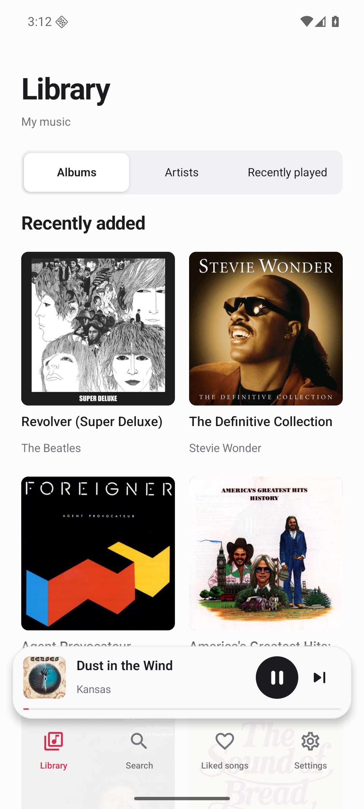
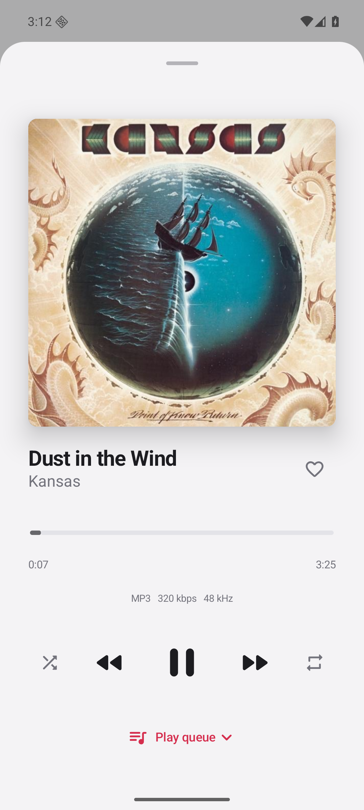
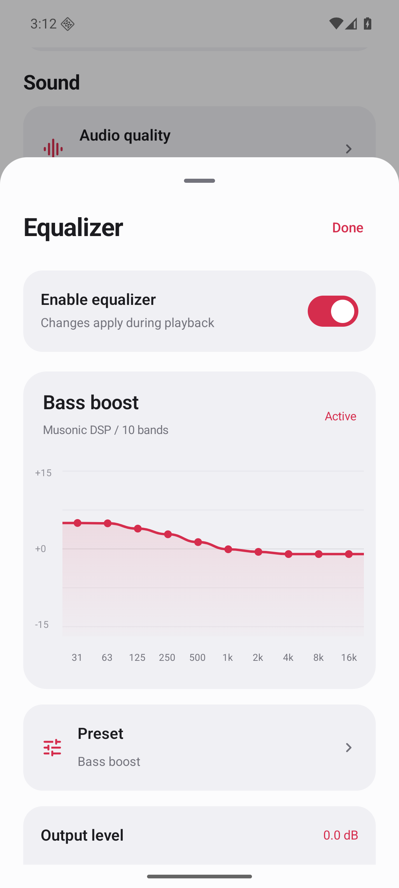
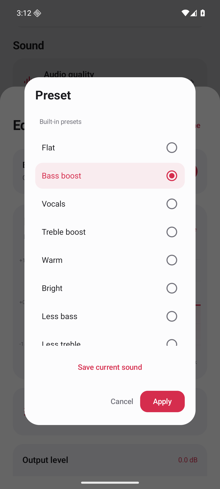

<p align="center"></p>
<p align="center">내 서버의 음악을 듣는 Android 플레이어</p>
<p align="center"><a href="https://github.com/ljaehwan/Musonic-releases/releases/latest">APK 다운로드</a> · <a href="docs/SERVER-SETUP.ko.md">Docker 서버 설정</a> · <a href="README.md">English</a> · <a href="https://github.com/sponsors/ljaehwan">후원</a></p>

Musonic은 Subsonic/OpenSubsonic 호환 서버에 연결하는 음악 앱입니다. Navidrome을 비롯한 호환 서버의 앨범과 아티스트를 탐색하고, 최근 들은 곡을 다시 재생할 수 있습니다. Kotlin과 Jetpack Compose로 만들었으며 무료로 사용할 수 있습니다. 광고와 분석 SDK는 없습니다.

<p align="center">   </p>

## 주요 기능

- 앨범·아티스트 탐색, 검색, 좋아요, 최근 재생
- 백그라운드 재생과 잠금 화면·알림 재생 제어
- 앱 내부 10밴드 이퀄라이저, 사용자 프리셋, 프리앰프, 좌우 채널 게인, 라우드니스 보정
- 원본 또는 MP3 64·128·192·320 kbps 스트리밍 요청
- 라이트·다크 모드와 한국어·영어·일본어·중국어 간체·스페인어
- 앨범 표지 캐시와 기기 내 서버 인증정보 암호화 저장

음질 변환은 서버의 트랜스코딩 지원 여부에 따라 달라집니다. Android Auto 탐색·재생 기능도 구현되어 있지만 실제 차량 검증은 진행 중입니다. [Android Auto 안내](docs/ANDROID-AUTO.md)를 참고하세요.

## 설치

[최신 릴리즈](https://github.com/ljaehwan/Musonic-releases/releases/latest)에서 APK를 설치한 뒤 서버 주소와 계정을 입력하세요. Android 8.0 이상이 필요하며 음악 서버와 음원은 별도로 준비해야 합니다.

서버 주소는 `https://music.example.com`처럼 HTTPS를 권장합니다. GitHub APK는 직접 허용한 경우 HTTP 연결도 지원합니다. 앱에서 새 버전을 확인하고 내려받을 수 있으며, 설치 시 Android 확인 화면이 표시됩니다.

Google Play는 등록 준비 중으로 아직 공개 스토어 주소가 없습니다. 직접 빌드한 앱이나 다른 배포 채널의 앱은 서명이 달라 재설치가 필요할 수 있습니다. 앱을 삭제하면 기기에 저장된 설정과 최근 재생 기록도 삭제됩니다.

## 음악 서버가 없다면

PC·NAS·홈 서버에 **Navidrome을 Docker로 실행**하고 음악 폴더를 연결하세요. Musonic에는 해당 서버 주소와 직접 만든 계정을 입력하면 됩니다.

[Docker Compose 예제](examples/navidrome)는 음악 폴더를 읽기 전용으로 연결하고 서버 DB를 별도로 보관합니다. [설정 안내](docs/SERVER-SETUP.ko.md)에 첫 계정 생성부터 Wi-Fi 연결, 집 밖에서 HTTPS로 듣는 방법까지 정리했습니다. Musonic 계정이나 구독은 필요하지 않습니다.

기존 Subsonic/OpenSubsonic 서버가 있다면 새로 설치하지 않고 그대로 연결할 수 있습니다.

| 서버 | Docker 설치 |
| --- | --- |
| [Navidrome](https://www.navidrome.org/) | [공식 Docker 안내](https://www.navidrome.org/docs/installation/docker/) |
| [Gonic](https://github.com/sentriz/gonic) | [프로젝트 Docker 안내](https://github.com/sentriz/gonic/wiki/installation#with-docker) |
| [Airsonic-Advanced](https://github.com/kagemomiji/airsonic-advanced) | [Docker 안내](https://github.com/kagemomiji/airsonic-advanced#docker) · [Compose 예제](https://github.com/kagemomiji/airsonic-advanced/tree/main/install/compose) |

Navidrome은 Musonic 연결·재생을 확인했습니다. Gonic과 Airsonic-Advanced는 Subsonic API를 제공하지만 Musonic에서 직접 테스트하지는 않았으며, 서버별로 지원 기능이 다를 수 있습니다.

## 개발 및 참여

JDK 17과 Android SDK 36을 준비한 뒤 다음 명령을 실행합니다.

```sh
./gradlew testDebugUnitTest testPlayUnitTest lintDebug lintPlay assembleDebug
```

자세한 내용은 [빌드 안내](docs/BUILDING.md)와 [기여 안내](CONTRIBUTING.md)에 있습니다. 오류나 기능 제안은 [Issues](https://github.com/ljaehwan/Musonic/issues/new/choose)로 보내주세요. 비밀번호와 인증정보가 포함된 URL은 공개하지 말아 주세요.

마음에 드셨다면 별표를 남겨주세요. 번역, 사용 후기, 오류 제보도 도움이 됩니다. [프로젝트 지원 안내](SUPPORT.md)

## Star history

<picture>
  <source media="(prefers-color-scheme: dark)" srcset="https://api.star-history.com/svg?repos=ljaehwan/Musonic&amp;type=Date&amp;theme=dark">
  <source media="(prefers-color-scheme: light)" srcset="https://api.star-history.com/svg?repos=ljaehwan/Musonic&amp;type=Date">
  
</picture>

[Star History에서 보기](https://www.star-history.com/#ljaehwan/Musonic&Date)

[MIT 라이선스](LICENSE) · [개인정보처리방침](https://ljaehwan.github.io/Musonic-releases/privacy/) · 문의: **hwandevlog@gmail.com**
