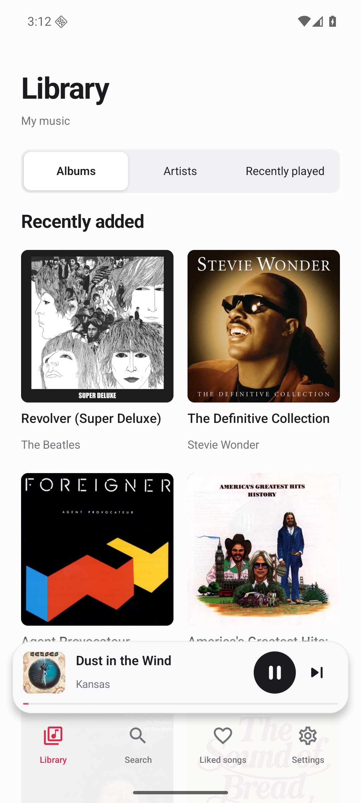
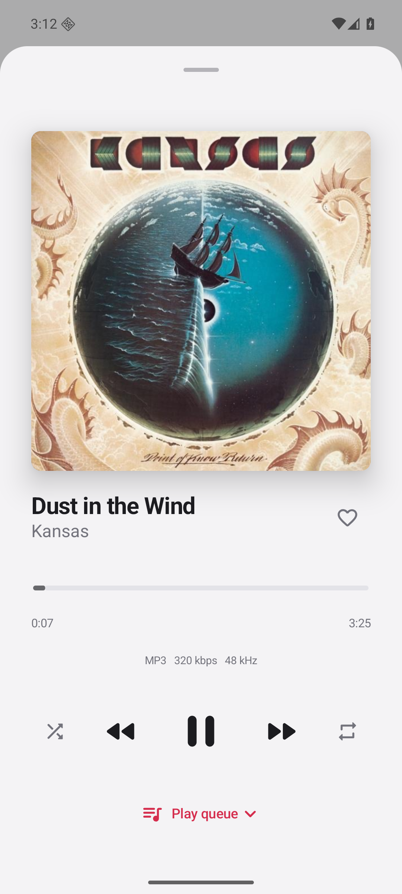
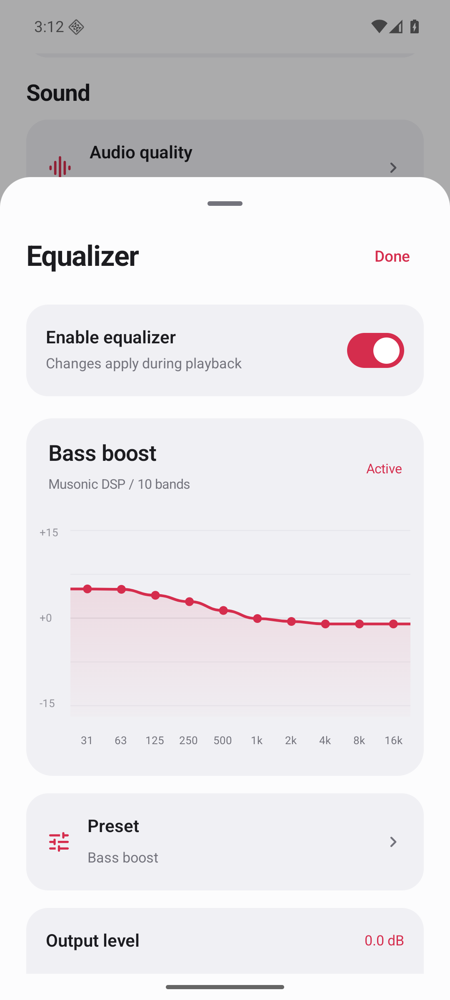
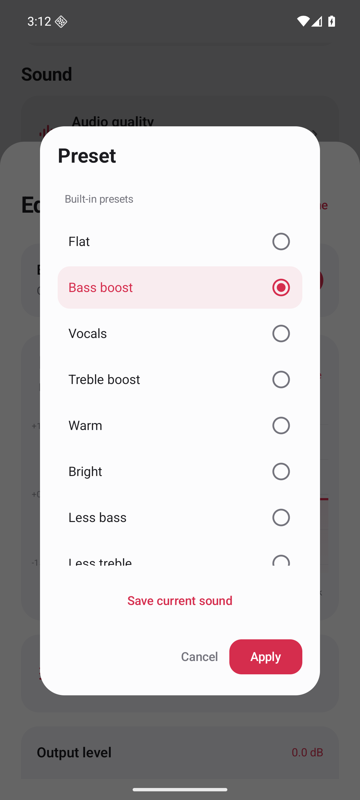

<p align="center"></p>
<p align="center">An Android player for the music on your own server.</p>
<p align="center"><a href="https://github.com/ljaehwan/Musonic-releases/releases/latest">Download APK</a> · <a href="docs/SERVER-SETUP.md">Docker server setup</a> · <a href="README.ko.md">한국어</a> · <a href="docs/BUILDING.md">Build from source</a> · <a href="https://github.com/sponsors/ljaehwan">Sponsor</a></p>
<p align="center"><a href="https://github.com/ljaehwan/Musonic/actions/workflows/android.yml"></a> <a href="LICENSE"></a>  <a href="https://github.com/ljaehwan/Musonic/stargazers"></a></p>

Musonic connects to Subsonic and OpenSubsonic servers, including Navidrome. It keeps your albums, recent listens and sound controls close at hand. Written in Kotlin with Jetpack Compose. Free to use, with no ads or analytics SDKs.

<p align="center">   </p>

## What it does

- Browse albums and artists, search your library, save favorites and return to recently played songs.
- Listen in the background with lock-screen and notification controls.
- Adjust a ten-band equalizer, save presets, and control preamp, channel balance and loudness independently.
- Stream original files or request MP3 at 64, 128, 192 or 320 kbps, where the server supports transcoding.
- Choose light or dark mode and Korean, English, Japanese, Simplified Chinese or Spanish.
- Cache album artwork and store server credentials encrypted on the device.

Android Auto browsing and playback are implemented, but still need testing on physical head units. See [Android Auto](docs/ANDROID-AUTO.md) before trying a sideloaded build in a car.

## Get started

Download the APK from [Musonic releases](https://github.com/ljaehwan/Musonic-releases/releases/latest), install it, and enter your server URL and account details. Musonic does not include music or a server account. Android 8.0 or newer is required.

Use an HTTPS address such as `https://music.example.com`. The direct APK also allows HTTP after an explicit opt-in. Server features and transcoding availability vary.

The GitHub APK checks for updates in the release repository and asks Android to confirm installation. Google Play registration is in progress; there is no public Play listing yet. Locally built APKs and store builds can have different signing keys, so switching distributions may require uninstalling first. Uninstalling removes local settings and history.

## Need a music server?

Run **Navidrome in Docker**, point it at your music folder, then connect Musonic with the server address and the account you create. A PC, NAS or home server is enough.

The included [Docker Compose example](examples/navidrome) mounts music read-only and keeps the server database in a separate folder. The [setup guide](docs/SERVER-SETUP.md) walks through first-run setup, phone connection on Wi-Fi, and HTTPS access away from home. No Musonic account or subscription is needed.

Already have a Subsonic/OpenSubsonic server? Use it directly; you don't need another container.

| Server | Docker installation |
| --- | --- |
| [Navidrome](https://www.navidrome.org/) | [Official Docker guide](https://www.navidrome.org/docs/installation/docker/) |
| [Gonic](https://github.com/sentriz/gonic) | [Project Docker guide](https://github.com/sentriz/gonic/wiki/installation#with-docker) |
| [Airsonic-Advanced](https://github.com/kagemomiji/airsonic-advanced) | [Docker guide](https://github.com/kagemomiji/airsonic-advanced#docker) · [Compose examples](https://github.com/kagemomiji/airsonic-advanced/tree/main/install/compose) |

Navidrome has been tested with Musonic. Gonic and Airsonic-Advanced provide Subsonic APIs, but have not yet been tested with Musonic; available features may differ.

## Build

Install JDK 17 and Android SDK 36, then run:

```sh
./gradlew testDebugUnitTest testPlayUnitTest lintDebug lintPlay assembleDebug
```

The APK is written to `app/build/outputs/apk/debug/app-debug.apk`. No server credentials or release signing key are needed. [Build instructions](docs/BUILDING.md) cover the Play variant and device tests.

## Contribute

Bug reports, translations and small fixes are welcome. If something breaks, include your Android version, Musonic version, server software and steps to reproduce it. Please remove passwords and authenticated URLs from logs and screenshots.

For larger changes, open an [issue](https://github.com/ljaehwan/Musonic/issues/new/choose) first so we can agree on the scope. See [CONTRIBUTING.md](CONTRIBUTING.md) for the development workflow and [SECURITY.md](SECURITY.md) for private reports.

If you enjoy Musonic, a star helps other people find it. [Ways to support the project](SUPPORT.md).

## Star history

<picture>
  <source media="(prefers-color-scheme: dark)" srcset="https://api.star-history.com/svg?repos=ljaehwan/Musonic&amp;type=Date&amp;theme=dark">
  <source media="(prefers-color-scheme: light)" srcset="https://api.star-history.com/svg?repos=ljaehwan/Musonic&amp;type=Date">
  
</picture>

[View on Star History](https://www.star-history.com/#ljaehwan/Musonic&Date).

## Privacy and license

[Privacy policy](https://ljaehwan.github.io/Musonic-releases/privacy/) · [Contact](mailto:hwandevlog@gmail.com)

Musonic source code is available under the [MIT license](LICENSE). Dependencies retain their own licenses. The wordmark uses Noto Sans outlines; see [third-party notices](THIRD_PARTY_NOTICES.md).
